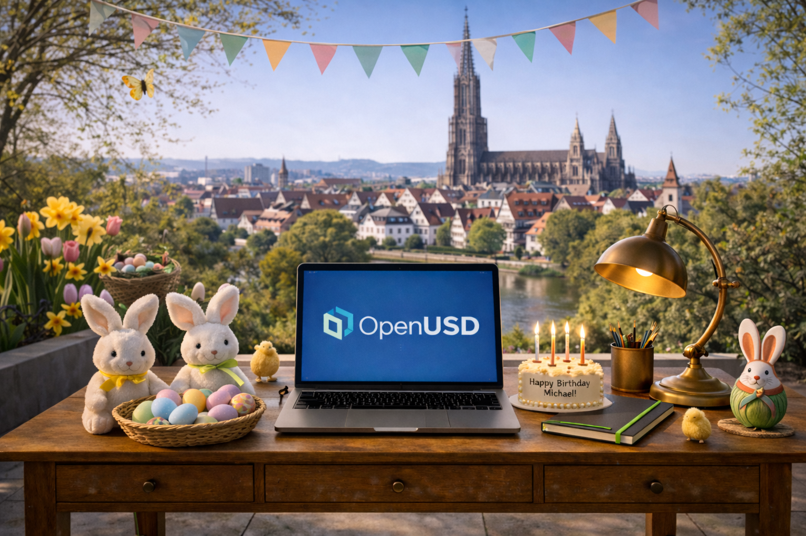
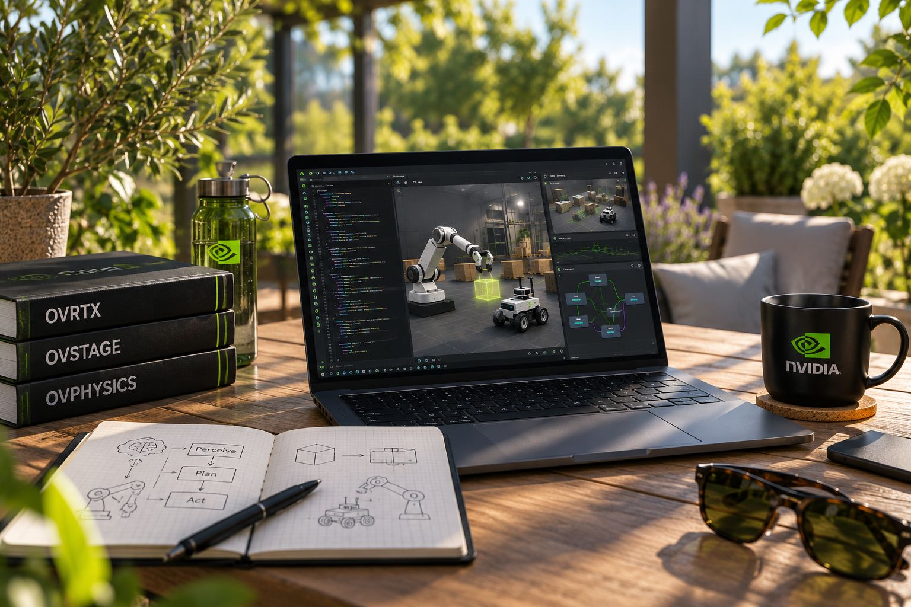

# From image references to a VR environment

The OpenUSD Studierstube was built procedurally in Blender using a Python script. The supplied images guided the design; this was not photogrammetry or automatic 3D reconstruction.

1. **Interpret the references.** Combine the wooden desk, OpenUSD laptop, brass lamp, books, plants, and warm outdoor atmosphere into an open study pavilion. The pergola was a design addition; the skyline and Easter decorations were omitted.
2. **Model with simple geometry.** Use cubes for furniture, planks, books, and laptop parts; cylinders for pots, branches, and lamp components; and low-resolution spheres for leaves and knobs. Small bevels soften edges.
3. **Use real-world scale.** Set metres as the scene units. The pavilion measures approximately 5.6 × 4.8 metres, with a desk surface around 0.82 metres high.
4. **Add materials and lighting.** Apply shared, solid-colour PBR materials for oak, brass, plaster, foliage, and fabric, with daylight-style lighting. No photographic textures are used, giving the scene a stylized appearance.
5. **Keep the asset lightweight.** The scene contains 41,860 triangles and has no external texture dependencies. Draw calls have not been optimized and Quest 3 performance has not been tested.
6. **Export and review.** Save the editable Blender scene, export USDZ using Blender's USD exporter, and render and visually inspect a preview. The USDZ has not been verified in a headset.

The result is a static 3D environment asset. Collision, physics, teleportation, and object interaction must be configured in the target VR application; the scene is not yet a validated SimReady or PhysX simulation asset.
